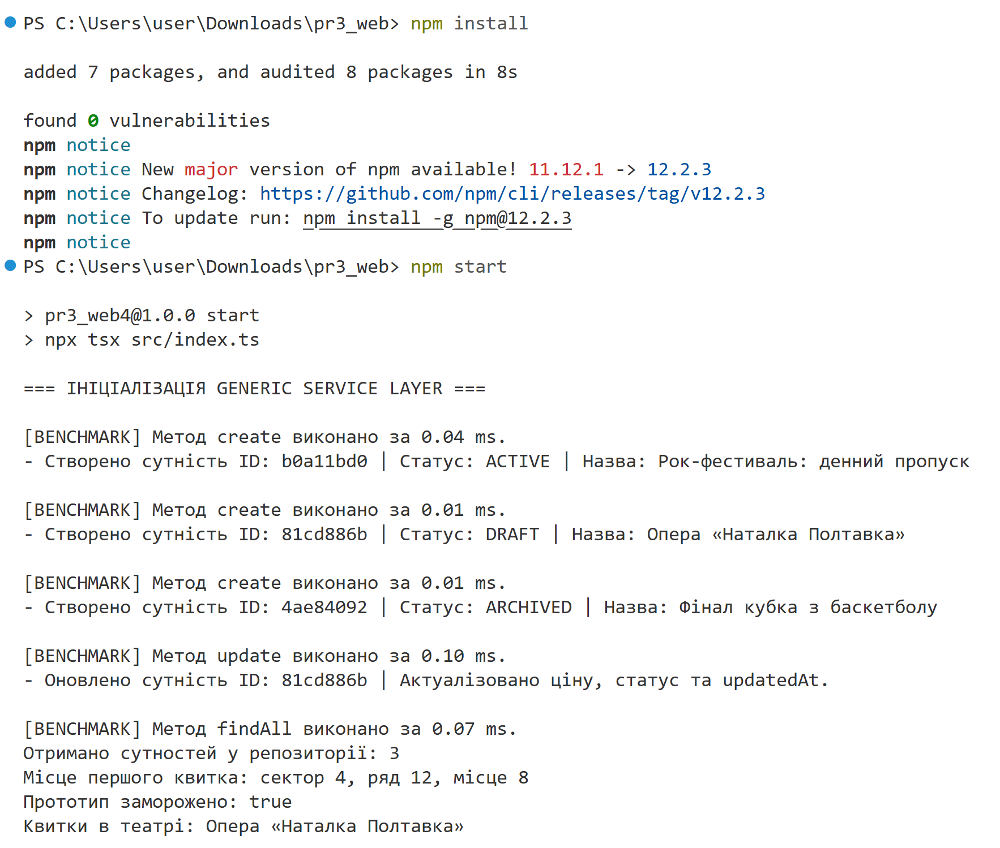
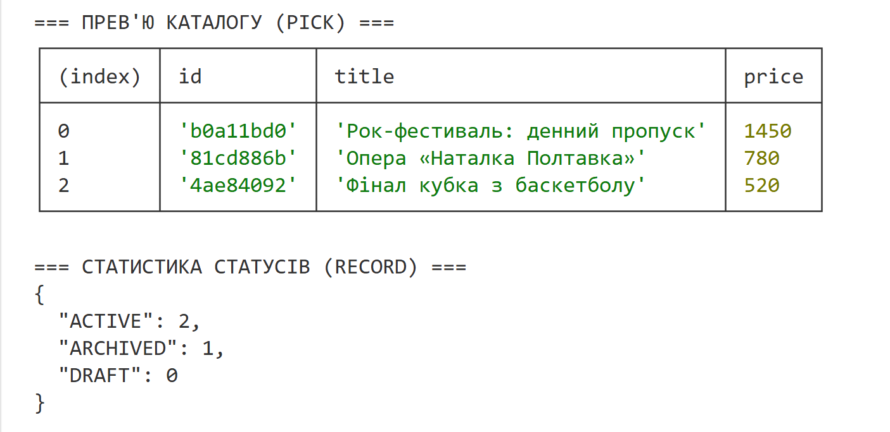
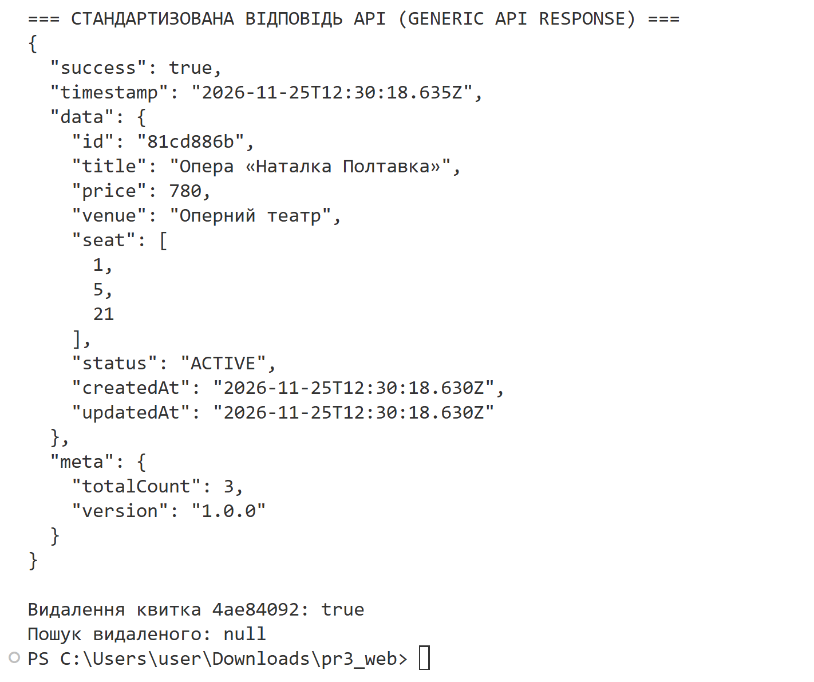

Практична робота № 3

Тема: Узагальнення, декоратори та утиліти типів TypeScript

Варіант: № 8 — Квитки на події (TicketEntity)

Репозиторій: pr3_web

Мета роботи
Опанувати розширені засоби мови TypeScript, критично необхідні для промислової розробки на NestJS: узагальнення (generics), утилітарні типи (utility types) та метапрограмування на основі декораторів (decorators).
Навчитися проєктувати типізовані архітектурні патерни, зокрема патерн репозиторію (Generic Repository Pattern) та універсальні обгортки API-відповідей (ApiResponse<T>).
Опанувати трансформацію типів для створення об'єктів передачі даних (DTO) за допомогою Partial<T>, Required<T>, Pick<T, K>, Omit<T, K> та Record<K, V>.
Навчитися створювати власні декоратори класів та методів з використанням дескрипторів властивостей (PropertyDescriptor), налаштувати компілятор для підтримки метаданих та організувати чисту модульну структуру за допомогою barrel files.
Опис реалізованого проєкту (In-Memory Generic Repository & Service Layer)
У межах роботи розроблено типізований сервісний шар та репозиторій у оперативній пам'яті для управління сутностями квиткової каси (Варіант № 8 — TicketEntity). Проєкт реалізовано у три послідовні рівні без використання типу any:

1. Рівень 1: Generic-інтерфейси та Generic In-Memory Repository
   Налаштовано конфігурацію компілятора у tsconfig.json із суворим режимом ("strict": true, "noImplicitAny": true) та підтримкою метапрограмування ("experimentalDecorators": true, "emitDecoratorMetadata": true).
   Спроєктовано базові контракти у src/types/:
   BaseEntity (id: string, createdAt: Date, updatedAt: Date) у entity.types.ts;
   ApiResponse<TData> (success, data, timestamp, meta?) у api.types.ts;
   IRepository<T extends BaseEntity> із базовими CRUD-операціями (create, findById, findAll, deleteById) у repository.types.ts.
   Реалізовано універсальний клас InMemoryRepository<T extends BaseEntity> (src/repositories/in-memory.repository.ts), який інкапсулює зберігання та операції над колекцією сутностей у пам'яті.

2. Рівень 2: Трансформація типів (Utility Types) та DTO
   Визначено перерахування статусів EntityStatus (Active = "ACTIVE", Archived = "ARCHIVED", Draft = "DRAFT") та додано поле status до моделі квитка TicketEntity (title, price, venue, seat: [sector: number, row: number, seat: number]) у src/types/ticket.model.ts.
   Налаштовано генерацію типів DTO за допомогою утилітарних типів у src/types/dto.types.ts:
   CreateDto<T> — через Omit<T, "id" | "createdAt" | "updatedAt"> для створення сутностей без системних полів;
   UpdateDto<T> — через Partial<CreateDto<T>> для часткового оновлення (PATCH);
   EntitySummary<T> — через Pick<T, "id" | "title" | "price"> для формування легковажного прев'ю;
   EntityAnalytics — через Record<EntityStatus, number> для типізації статистики за статусами.
   Розширено контракт IRepository<T> та клас InMemoryRepository<T> методом update(id: string, patch: UpdateDto<T>): T | null, який зберігає незмінність id та оновлює мітку updatedAt.

3. Рівень 3: Метапрограмування та архітектурна модульність
   Розроблено декоратор методу @LogExecutionTime() (src/decorators/log-execution-time.decorator.ts), який перехоплює виклик через PropertyDescriptor, вимірює час виконання за допомогою performance.now() та виводить у консоль повідомлення формату [BENCHMARK] Метод <MethodName> виконано за <Time> ms..
   Розроблено декоратор класу @FrozenEntity() (src/decorators/frozen-entity.decorator.ts), який застосовує Object.freeze() до конструктора класу та його прототипу для захисту від модифікації під час виконання.
   Реалізовано предметний репозиторій TicketRepository (src/repositories/ticket.repository.ts) із застосуванням декораторів @LogExecutionTime() до методів роботи з квитками та моделі TicketEntity з декоратором @FrozenEntity().
   Організовано централізований реекспорт модулів через Barrel Files (src/types/index.ts, src/repositories/index.ts, src/decorators/index.ts) та інтеграційну демонстрацію повного циклу роботи у src/index.ts.

Структура проєкту

pr3_web/
├── src/
│ ├── decorators/
│ │ ├── frozen-entity.decorator.ts # Декоратор класу @FrozenEntity()
│ │ ├── log-execution-time.decorator.ts # Декоратор методу @LogExecutionTime()
│ │ └── index.ts # Barrel file для декораторів
│ ├── repositories/
│ │ ├── in-memory.repository.ts # Базовий Generic In-Memory Repository
│ │ ├── ticket.repository.ts # Предметний репозиторій квитків (Варіант № 8)
│ │ └── index.ts # Barrel file для репозиторіїв
│ ├── types/
│ │ ├── api.types.ts # Універсальна обгортка ApiResponse<TData>
│ │ ├── dto.types.ts # DTO на базі Omit, Partial, Pick, Record
│ │ ├── entity.types.ts # Базовий інтерфейс BaseEntity та enum EntityStatus
│ │ ├── repository.types.ts # Контракт інтерфейсу IRepository<T>
│ │ ├── ticket.model.ts # Модель сутності квитка TicketEntity
│ │ └── index.ts # Barrel file для типів
│ └── index.ts # Точка входу та демонстрація роботи сервісного шару
├── package.json # Залежності (typescript, tsx, @types/node) та скрипти
├── package-lock.json # Фіксація версій встановлених пакетів
├── tsconfig.json # Конфігурація TypeScript (strict + decorators)
└── README.md # Документація та звіт про виконання роботи

Інструкція із запуску
1.Встановлення залежностей:
npm install

2.Перевірка суворої типізації та декораторів без генерації JS-файлів:
npx tsc --noEmit

3.Запуск демонстраційного сценарію (tsx):
npm start

Результати роботи програми

Висновки

Під час виконання практичної роботи № 3 було опановано розширені засоби системи типізації TypeScript: узагальнення з обмеженнями (extends), вбудовані утилітарні типи (Omit, Partial, Pick, Record) та декоратори класів і методів. Реалізація патерну Generic Repository для сутності TicketEntity дозволила інкапсулювати логіку зберігання та оновлення даних, забезпечити сувору типізацію DTO-об'єктів і стандартизованих відповідей ApiResponse<T>, а використання Barrel Files зробило архітектуру проєкту чистою, модульною та готовою до масштабування.
